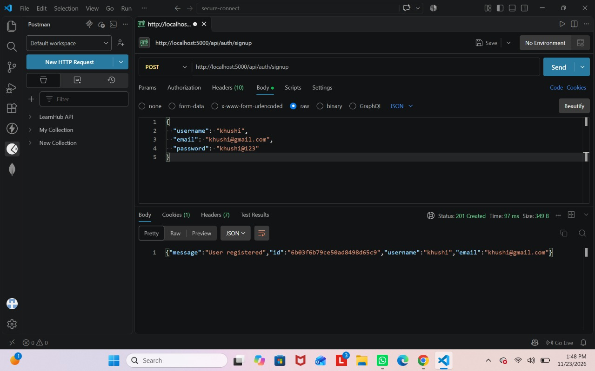
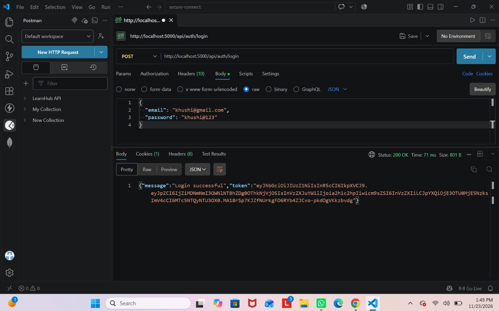
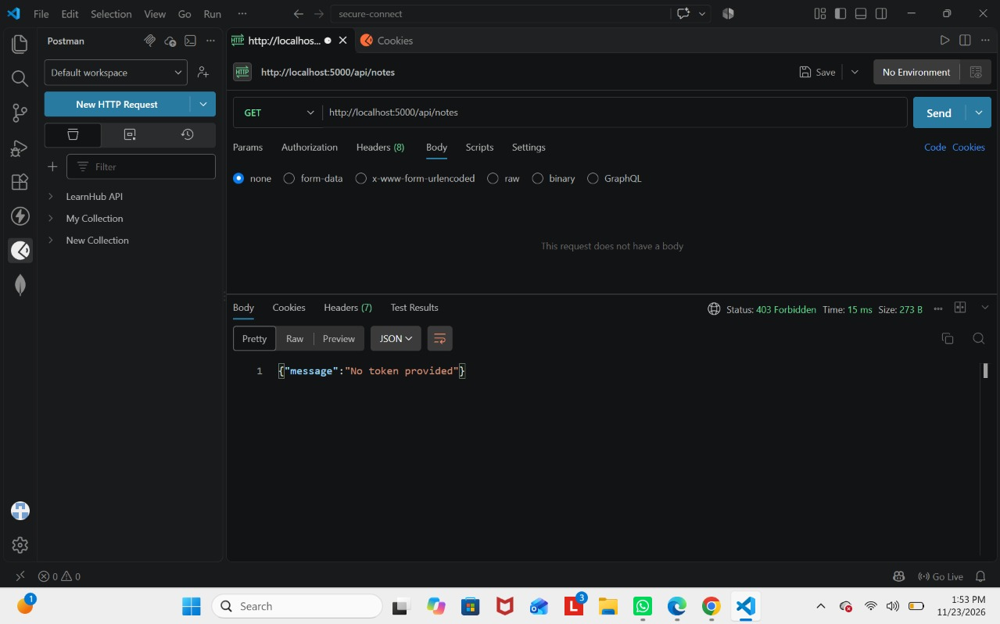
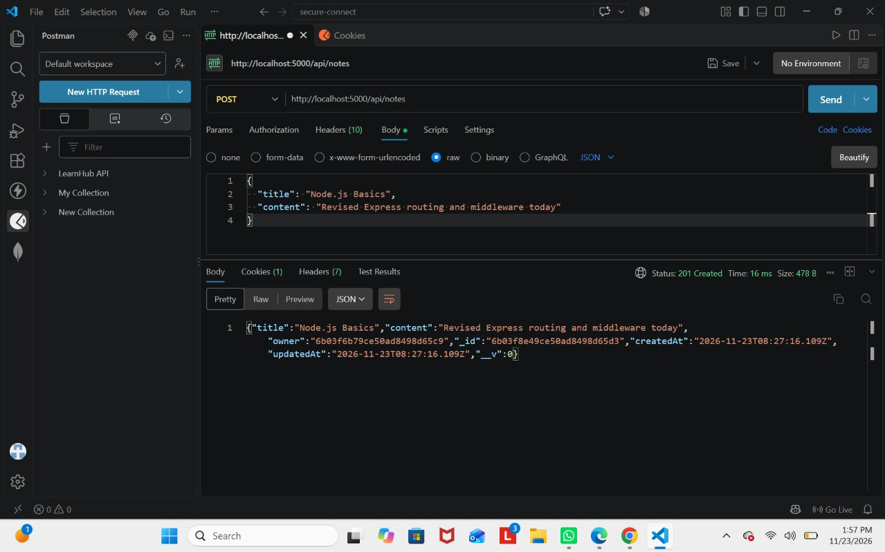
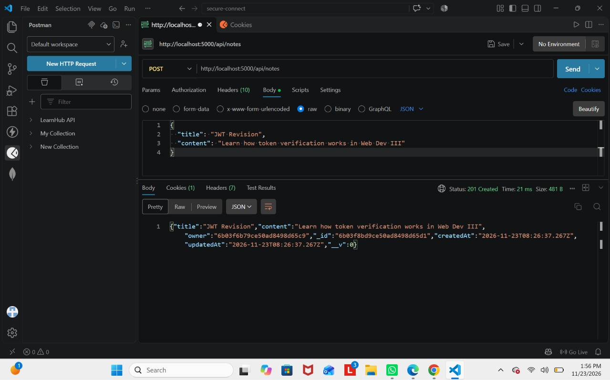
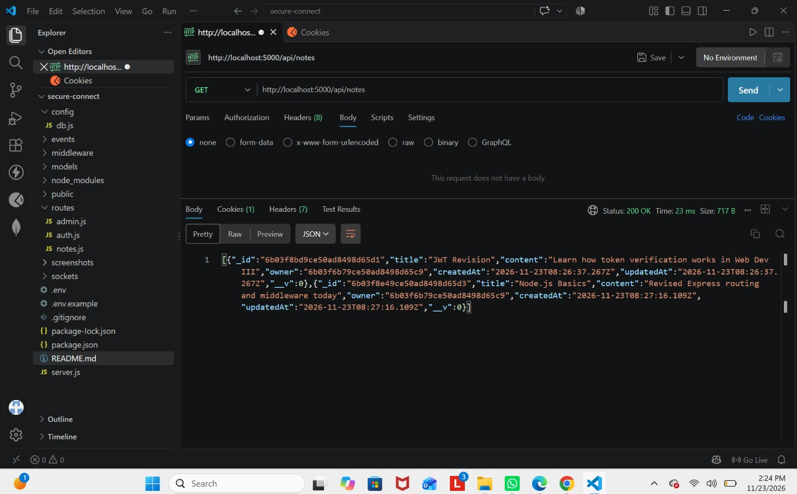

# Lab 4: Secure Connect and Communication Platform

Course: Web Dev III · Unit 4

A Node.js backend with secure signup/login (bcrypt + JWT), protected routes with
role-based access control (RBAC), a Notes CRUD API, real-time chat (Socket.IO) and
event-driven logging (EventEmitter). No auth boilerplate or starter kits were used.

## Tech Stack
Node.js · Express · jsonwebtoken · bcrypt · dotenv · Socket.IO · MongoDB (Mongoose)

## Project Structure
```
├── server.js              # App entry: Express + HTTP server + Socket.IO
├── config/db.js           # MongoDB connection
├── models/                # User and Note schemas
├── middleware/auth.js     # verifyToken (JWT) + authorizeRoles (RBAC)
├── routes/                # auth, notes, admin routes
├── events/                # EventEmitter bus + listeners
├── sockets/chat.js        # JWT-authenticated real-time chat
├── public/index.html      # Minimal chat client
└── screenshots/           # Postman screenshots (see below)
```

## Setup
```bash
git clone <your-repo-url>
cd secure-connect
npm install
cp .env.example .env     # then set JWT_SECRET and MONGO_URI
npm start                # http://localhost:5000
```

## API Endpoints

| Method | Endpoint | Auth | Description |
|-------:|----------|------|-------------|
| POST | `/api/auth/signup` | – | Register (password hashed with bcrypt) |
| POST | `/api/auth/login` | – | Returns JWT (also set as `token` cookie) |
| POST | `/api/auth/logout` | – | Clears the cookie |
| GET | `/api/admin/me` | JWT | Current user info |
| GET | `/api/admin/users` | JWT + admin | List all users (RBAC) |
| POST | `/api/notes` | JWT | Create note |
| GET | `/api/notes` | JWT | List own notes (admin: all) |
| GET | `/api/notes/:id` | JWT | Get one note |
| PUT | `/api/notes/:id` | JWT | Update note |
| DELETE | `/api/notes/:id` | JWT | Delete note |

The JWT is accepted as `Authorization: Bearer <token>` or the `token` cookie.
Signing up with the email in `ADMIN_EMAIL` creates an `admin` user.

## Real-Time Chat (Socket.IO)
Connect with `io({ auth: { token } })`. Events: `joinRoom`, `chatMessage`, `typing`
(client → server) and `chatMessage`, `systemMessage`, `typing` (server → clients).
Open `http://localhost:5000` for a simple test client.

## EventEmitter
`events/eventBus.js` exports one shared emitter. Events: `user:registered`,
`user:loggedIn`, `auth:failed`, `note:created`, `note:deleted`, `chat:message`.

## Postman Screenshots

### 1. Signup


### 2. Login


### 3. Notes API blocked without token (403)


### 4. Create note with valid JWT (201)


### 4. Create note with valid JWT (201)


### 5. Get all notes with valid JWT (200)
